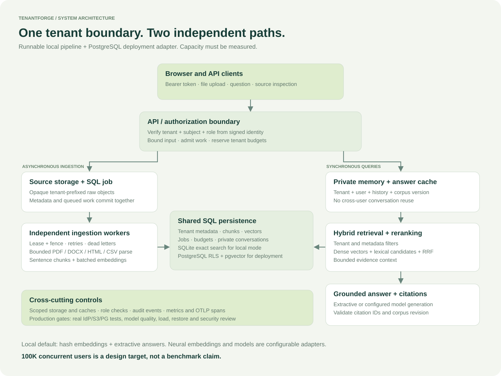

# TenantForge RAG

**A runnable multi-tenant RAG platform with asynchronous ingestion, hybrid retrieval, cited answers, private conversations, and an evidence-based deployment guide.**

Built from the ten requirements in the supplied multi-tenant RAG problem statement. The default mode needs no model API key: it parses your actual documents, indexes them, retrieves passages and returns cited excerpts. It does not return canned answers. Hash embeddings and extractive answers are deliberately labeled as a demonstration mode; enable a neural embedding backend and an LLM for semantic generation.



## Start in three steps

Python 3.11+; tested on Python 3.12.14. From this directory:

```bash
python -m venv .venv
source .venv/bin/activate
pip install -e '.[dev]'
python -m tenantforge demo
```

Open **http://127.0.0.1:8000**, paste the short-lived token printed in your terminal, and upload a file from `examples/`. Wait for **ready**, then ask: **“What is the annual leave policy?”** Click a citation to inspect its source. The demo supervises a worker thread for convenience; normal deployment uses independent processes.

Windows: use `.venv\Scripts\activate` instead of `source`. Parser memory/CPU limits use POSIX `resource` when available; the wall-clock timeout also applies on Windows. No OCR or remote webpage crawling is included.

## What is implemented

| Requirement | Working implementation | Important boundary |
|---|---|---|
| Document ingestion | Multipart PDF, DOCX, HTML, CSV, TXT and Markdown upload; durable job created in the metadata transaction | HTML is an uploaded file; arbitrary URLs are never fetched |
| Processing | Text cleaning, headings attached to content, sentence-aware bounded chunks, page/paragraph/row locators | Scanned PDFs require external OCR; splitting is structural, not learned topic segmentation |
| Embeddings | Batching, tenant/model/content cache, retries; hash, compatible embeddings API and Sentence Transformers adapters | Neural/provider paths need models or credentials |
| Vector storage | SQLite exact cosine for local use; PostgreSQL pgvector HNSW index for deployment | SQLite intentionally caps corpus scans |
| Retrieval | BM25 + cosine locally; PostgreSQL FTS `ts_rank_cd` + pgvector; reciprocal rank fusion; metadata filters; reranking | PostgreSQL FTS is not BM25; optional cross encoder needs the semantic extra |
| Generation | Cited extractive answers or compatible chat-completions API; citation ID validation and abstention | Valid citation IDs do not prove factual entailment |
| Conversation memory | User-and-tenant-owned history, bounded context, conservative follow-up expansion, version/fence checks | Last 20 messages stored; old-corpus history excluded from future prompts |
| Scalability | Independent API/workers, durable leased jobs, `SKIP LOCKED` on PostgreSQL, Docker and Kubernetes templates | **100K concurrent users is a capacity-design target, not a verified result** |
| Tenant isolation | Verified JWT tenant identity, role checks, scoped SQL, PostgreSQL forced RLS, storage prefixes, private caches and memory | Real OIDC/IAM/PG deployment must be verified in the target environment |
| Cost controls | Admission limits, daily reservation budget, input/context/output bounds, embedding/answer caches, model routing | Reservation units are not provider invoices or a hard currency cap |

## Run API and worker separately

```bash
python -m tenantforge init --tenant acme
python -m tenantforge token --tenant acme --user alice --role editor
python -m tenantforge worker
# In another terminal, using the same configuration:
python -m tenantforge serve
```

The SQLite database and objects persist under `data/`. Set matching `TF_*` variables in both terminals. SQLite is for a single host; use PostgreSQL and S3 for multiple nodes. The default development signing key is public and intentionally unsuitable for a shared service.

## PostgreSQL + pgvector with Docker Compose

```bash
docker compose up --build -d
docker compose exec api python -m tenantforge token --tenant acme --user alice
docker compose logs -f worker
```

The migration job creates tables, HNSW/FTS indexes and forced row policies. The API uses `rag_app`; the worker uses `rag_worker`; neither is a superuser or table owner. Admin credentials exist only in the migration service. Compose credentials are local examples, and the API binds to loopback. Raw objects use a shared local volume, so this Compose profile is a single-host deployment.

```bash
docker compose up -d --scale worker=3
docker compose run --rm migrate python -m tenantforge init --tenant beta
docker compose exec api python -m tenantforge token --tenant beta --user bob
```

These Compose commands are provided for execution on your machine. Docker and PostgreSQL were unavailable in the build environment; see `docs/VALIDATION.md` for the exact verification scope.

## Enable semantic retrieval and a real model

Use a **fresh database/corpus** when changing embedding models. The fingerprint check prevents mixing embedding spaces; there is no automatic in-place model migration.

```bash
export TF_DATABASE_URL=sqlite:///./data/semantic.db
export TF_EMBEDDING_BACKEND=openai
export TF_EMBEDDING_MODEL=text-embedding-3-small
export TF_EMBEDDING_DIMENSIONS=384
export TF_GENERATION_BACKEND=openai
export TF_PROVIDER_API_KEY='YOUR_KEY'
export TF_LLM_MODEL='YOUR_CHAT_COMPLETIONS_COMPATIBLE_MODEL'
python -m tenantforge demo
```

The compatible gateway must accept `/embeddings` with a `dimensions` field and `/chat/completions` with `max_tokens`, `temperature`, and messages. Set `TF_PROVIDER_BASE_URL` for your gateway. Choose a model that supports this contract; the adapter is not a universal model API. No live paid model call was made during validation.

For local neural embeddings and reranking:

```bash
pip install -e '.[semantic]'
export TF_EMBEDDING_BACKEND=sentence_transformers
export TF_EMBEDDING_MODEL=sentence-transformers/all-MiniLM-L6-v2
export TF_EMBEDDING_DIMENSIONS=384
export TF_RERANKER=cross_encoder
```

Download/model-license review and model quality tests are your deployment responsibilities. The semantic extra is optional and was not installed or benchmarked here. `trust_remote_code=False` is used.

## API examples

```bash
export TOKEN="$(python -m tenantforge token --tenant acme --user alice)"
curl -X POST http://127.0.0.1:8000/v1/documents \
  -H "Authorization: Bearer $TOKEN" \
  -F 'file=@examples/handbook.md' -F 'metadata={"department":"hr"}'

# Query after /v1/documents reports status=ready:
curl -X POST http://127.0.0.1:8000/v1/query \
  -H "Authorization: Bearer $TOKEN" -H 'Content-Type: application/json' \
  -d '{"question":"What is the annual leave policy?","filters":{"department":"hr"},"top_k":5}'
```

Pass the returned `conversation_id` on later questions. The API takes the tenant and user from the verified token, never from an `X-Tenant-ID` header or a request body. Endpoint reference: `docs/API.md`; interactive OpenAPI: `/docs`.

## Verification commands

```bash
pytest -q
ruff check .
python scripts/evaluate.py
python scripts/verify_local.py

# Optional actual-browser check:
npm install
npx playwright install chromium
python scripts/verify_local.py --browser
```

`requirements-tested.txt` records the resolved Python dependency versions used during validation. For that exact environment use `pip install -r requirements-tested.txt` followed by `pip install --no-deps -e .`. Optional neural dependencies are excluded. Pin deployment images and refresh dependencies after your vulnerability review.

The PostgreSQL test module runs when `TEST_ADMIN_DATABASE_URL`, `TEST_DATABASE_URL`, and `TEST_WORKER_DATABASE_URL` are set. CI contains a real pgvector service and exercises the row policies with non-owner roles. The workflow is included; it has not been run on a remote GitHub repository.

## Read the design

- [Detailed architecture](docs/ARCHITECTURE.md): components, flows, schema, consistency, isolation and tradeoffs.
- [100K-user capacity plan](docs/SCALING.md): traffic assumptions, concurrency math, bottlenecks, sharding and load qualification.
- [Operations and failure handling](docs/OPERATIONS.md): startup, auth, retries, deletion, recovery and alerts.
- [Security notes](docs/SECURITY.md): trust boundaries, threats, implemented controls and remaining gaps.
- [Evaluation and cost notes](docs/EVALUATION.md): retrieval quality, grounding, latency and budget methodology.
- [API contracts](docs/API.md) and [five demo walkthroughs](docs/DEMO.md).
- [Validation evidence](docs/VALIDATION.md): executed checks and checks still pending.

## Source map

| Path | Responsibility |
|---|---|
| `tenantforge/api.py`, `auth.py`, `config.py` | HTTP contracts, JWT/OIDC validation, runtime configuration |
| `tenantforge/service.py` | Authorization-aware use cases, query orchestration and conversation/cache consistency |
| `tenantforge/db.py` | Shared schema, transactions, quotas, PostgreSQL row policies and indexes |
| `tenantforge/worker.py`, `processing.py` | Durable queue, leases, retries, bounded parser subprocess and chunking |
| `tenantforge/providers.py`, `retrieval.py` | Embeddings, rerankers, answer generation, BM25/FTS/vector retrieval and fusion |
| `tenantforge/storage.py`, `maintenance.py` | Local/S3 storage, cleanup and retention primitives |
| `tenantforge/telemetry.py`, `static/` | Metrics/traces and browser dashboard |
| `tests/`, `evals/`, `scripts/` | Functional/security/provider tests, quality cases and runnable verification tools |
| `infra/`, `compose.yaml`, `.github/workflows/` | Deployment templates, alerts and CI |

This is a working reference implementation. It is not a claim of production readiness, external deployment, a security certification or demonstrated 100K-user capacity.
