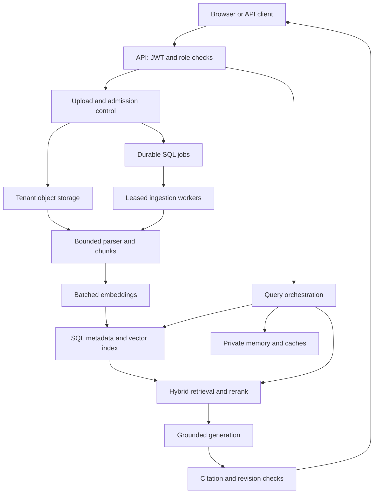
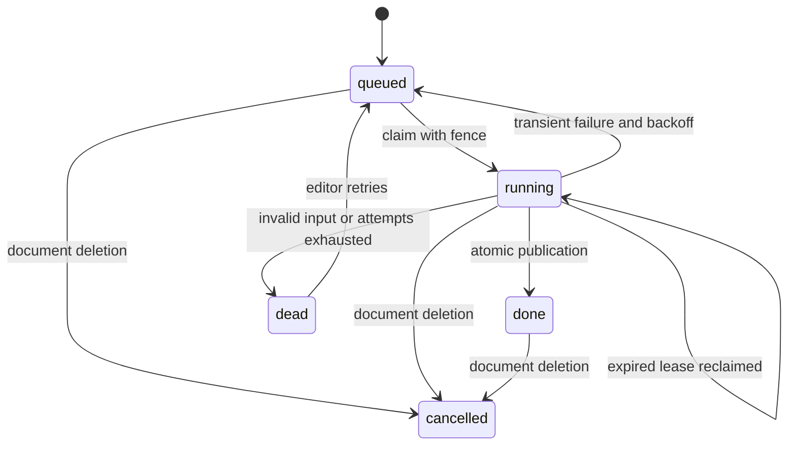
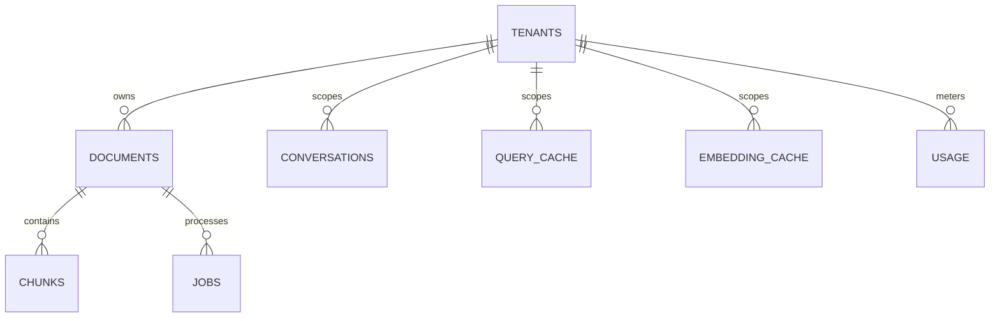

# TenantForge RAG — detailed architecture

## 1. Scope and architectural position

The platform separates the **write path** (asynchronous document ingestion) from the **read path** (synchronous query serving). The repository implements both paths, including the state needed to survive application restarts. It favors explicit Python modules over an agent framework because the requested pipeline has predictable steps and does not require autonomous tool selection.

The same domain service runs in two storage profiles:

| Concern | Local profile | Deployment profile |
|---|---|---|
| Metadata, queue, quotas, conversations, caches | SQLite WAL | PostgreSQL |
| Dense retrieval | Exact cosine in Python, capped scan | pgvector HNSW cosine index |
| Lexical retrieval | BM25 over tenant-filtered chunks | English PostgreSQL FTS with `ts_rank_cd` |
| Raw source bytes | Opaque files under tenant prefixes | Private S3 bucket through server-side credentials |
| Authentication | Short-lived locally signed HS256 token | RS256 token validated against trusted HTTPS JWKS, issuer and audience |
| Embeddings | Signed feature hashing | Compatible embeddings API or Sentence Transformers |
| Reranking | Lexical coverage plus RRF | Same baseline or optional CrossEncoder |
| Answering | Dynamically selected excerpts | Compatible chat-completions API with evidence |

The deployment profile is implemented but requires external verification. The full local path and provider wire contracts are tested. No model key is embedded in the code.

## 2. Implemented component architecture



The SQL queue is intentionally part of the same persistence layer as metadata. Upload admission and job creation therefore commit atomically. An external broker would introduce an additional database-to-broker transaction boundary and need an outbox or equivalent delivery mechanism. PostgreSQL leased jobs provide a runnable middle ground; they are not asserted to be the best queue at every workload.

## 3. Asynchronous ingestion flow

1. The HTTP request is bounded; only supported extensions and bounded string metadata are accepted. Authentication supplies the tenant and subject. Reader tokens cannot upload.
2. The service generates an opaque UUID object key under the verified tenant prefix. User filenames are display metadata, never object paths.
3. Source bytes are written to local/S3 storage. A short tenant-row lock serializes admission checks: maximum documents and pending jobs. Duplicate content with the same name and metadata reuses the existing document only inside that tenant.
4. The service inserts the document and job in one SQL transaction and returns `202`. A database failure triggers best-effort removal of the just-written object. A process crash between these storage systems can leave an orphan; the operations notes explain reconciliation.
5. A worker claims a due job. PostgreSQL uses `FOR UPDATE SKIP LOCKED`; a conditional update also checks the old attempt count. A lease and random fence identify this attempt.
6. A parser subprocess extracts text. It has a wall-clock timeout and, on POSIX, CPU/address-space limits. DOCX expanded size and archive entry counts, PDF page count, extracted character count, and chunk count are bounded.
7. Paragraphs, sentences and headings guide splitting. Long sentences have a hard split. Each chunk retains a page, paragraph, section or row locator. Text and locators do not cross tenant boundaries.
8. Missing embeddings are generated in batches. The cache key includes tenant, embedding fingerprint and text. The worker renews its lease before batches and before committing cached embeddings. Provider errors have bounded retries; exhausted jobs become dead letters.
9. Publication is one transaction: verify the job fence and lease, ensure the document is not deleted, replace its chunks, set the document ready, finish the job and increment the tenant corpus version. PostgreSQL stores each vector in the vector column; the shared JSON column is empty in this profile.



Delivery semantics are **at least once**. A process can fail after a paid provider call and before committing its cache entry. The system does not claim exactly-once provider billing. Stable chunk IDs, transactional replacement and fence validation make duplicate processing safe for the searchable corpus.

## 4. Synchronous query flow

1. Verify JWT signature, algorithm, expiry, issuer, audience and required claims. Load a provisioned tenant and enforce the embedding fingerprint.
2. Reserve the tenant rate-limit unit. Create a private conversation or acquire its lease. A conversation ID belonging to a different user or organization returns `404`.
3. Capture the current corpus version. Load only bounded history from that same version. A short/pronominal follow-up appends the previous user question to retrieval text; this is a simple deterministic heuristic, not a general conversational query-rewrite model.
4. Construct an answer-cache key with tenant, user, corpus version, question, bounded history, filters, top-k, route, embedding/generation/reranker configuration, context/output limits and prompt version.
5. On a miss, get the question embedding. Retrieve a dense candidate list and lexical candidate list under tenant and metadata filters. Fuse with reciprocal rank fusion: `RRF(d) = sum(1 / (60 + rank_i(d)))`.
6. Rerank up to 30 fused candidates. The baseline uses query coverage plus RRF. The neural option scores query/passage pairs with a CrossEncoder. Pack at most `top_k` passages within the context character limit.
7. Reserve generation budget units. Choose the standard model or the configured larger model for the explicit `deep` route. Generate a response from evidence. Extractive mode quotes the best overlapping sentences; model mode receives a system instruction distinguishing sources from instructions.
8. Validate citation numbers against the provided sources. If model output has no valid citation set, return an abstention. This is a structural grounding check, not an entailment proof.
9. Before committing the answer/history, conditionally lock the same corpus revision. If ingestion or deletion changed it, return `409`. Check the conversation fence and version, append a bounded turn, persist the answer cache and record an audit event.
10. Return text, citations with authorized source URLs, model/mode, corpus version, cache status, conversation ID and elapsed service time.

```mermaid
sequenceDiagram
    participant C as Client
    participant A as API
    participant D as SQL store
    participant R as Retrieval
    participant M as Model
    C->>A: Question and optional conversation ID
    A->>D: Verify owner, budget, lease and corpus version
    A->>D: Private cache lookup
    alt Cache miss
        A->>R: Tenant query, filters and embedding
        R->>D: Dense and lexical candidates
        D-->>R: Authorized passages
        R-->>A: Reranked context
        A->>M: Evidence and bounded conversation
        M-->>A: Answer and citation markers
    end
    A->>D: Validate revision and append turn atomically
    alt Corpus or conversation changed
        A-->>C: 409; retry
    else Valid snapshot
        A-->>C: Cited answer
    end
```

The transaction is not held open while waiting for model generation. A final short revision check rejects stale work. An answer can naturally precede a deletion that occurs after its commit; the ordering is defined by this commit point. Clicking a source always rechecks current authorization and document availability.

## 5. Data model

| Table | Identity and important fields | Isolation and purpose |
|---|---|---|
| `tenants` | `tenant_id`, `corpus_version`, `embedding_fingerprint` | Provisioned organization and corpus consistency |
| `documents` | UUID, tenant, filename, object key, fingerprint, metadata, state, size, timestamps | Organization-visible sources; uniqueness includes tenant |
| `chunks` | UUID, tenant, document, ordinal, content, locator, vector | Composite document FK includes tenant; unique ordinal per tenant/document |
| `jobs` | UUID, tenant, document, state, attempts, availability, lease, fence | Durable work scheduling and dead-letter state |
| `conversations` | UUID, tenant, user, messages, version, lease, fence | Private bounded history; both tenant and user checked |
| `query_cache` | Tenant, user, hashed key, payload, expiry | Private answer cache; corpus version is in the key |
| `embedding_cache` | Tenant, hashed model/content key, vector, timestamp | Tenant-local reuse, no cross-customer content deduplication |
| `usage` | Composite tenant/bucket key, units | Atomic rate/budget reservations |
| `audit_events` | UUID, tenant, user, action, resource ID, timestamp | Content-free event trail; no prompt or raw document logged |



Indexes include tenant columns, queue claim fields, document metadata GIN, English `tsvector` GIN and cosine HNSW. PostgreSQL approximate search with filters may return fewer candidates; iterative scans are enabled and `ef_search` is set locally to 100. These defaults require workload-specific recall/latency tuning. The local adapter computes BM25 document frequencies after filtering and rejects oversized corpus scans instead of silently truncating the corpus.

## 6. Tenant isolation as an end-to-end invariant

The tenant ID comes only from a signed, trusted identity assertion. A query cannot supply a different tenant. Every repository operation also applies explicit tenant predicates. PostgreSQL adds forced row policies based on transaction-local `app.tenant_id`; conversation/cache policies also require `app.user_id`.

`set_config(..., true)` limits context to the transaction, so a pooled connection cannot retain the preceding request’s tenant after commit. With no tenant context, policies deny data. The API role does not own tables and cannot disable policies. Production readiness checks reject superuser/BYPASSRLS credentials, table ownership and missing/non-forced policies.

The worker role has a deliberately broader policy on **jobs only**, allowing discovery of tenant work. It still sets the job’s tenant context to access source data and vectors. It cannot access conversations or answer caches. A worker is a trusted backend identity, not an untrusted client. Its queue visibility must remain internal.

RLS is defense against accidental unscoped queries, not a defense against arbitrary SQL execution as a fully compromised application that can set its own transaction context. Prevent SQL injection, restrict credentials/network access and use dedicated database/storage tenancy where the risk warrants it.

## 7. Consistency and race handling

| Race/failure | Behavior |
|---|---|
| Two workers claim one job | Lock/conditional attempt check chooses a winner; fences guard publication |
| Worker crashes while running | Lease expires; another worker retries; exhausted attempts eventually dead-letter |
| Old worker returns after lease reassignment | Fence mismatch prevents publication and cache write under that job |
| User deletes a processing document | Cancel job/fence first, tombstone document, remove chunks, bump corpus; stale worker cannot resurrect it |
| Model returns while corpus changes | Final revision check returns `409`; stale response is not appended or served |
| Two queries use one conversation | Lease returns `409` for concurrent work; version/fence protects final append |
| User deletes an active conversation | Final append fails; no conversation is silently recreated |
| API process dies after raw storage write | Possible orphan object; reconciliation is required |
| S3 delete fails | Retrieval is revoked immediately; tombstone retains key for cleanup retry |
| Provider is unavailable | Limited retries; sanitized `502` or queued retry; no silent fabricated model answer |

## 8. Deliberate tradeoffs

- A single PostgreSQL service reduces moving parts and supports metadata/vector transactions. At larger scale, query caches, budget counters and queue traffic contend with retrieval; `SCALING.md` describes moving these out and sharding by tenant.
- A per-tenant corpus revision makes invalidation straightforward. A large tenant with high ingestion/query churn becomes a hotspot; collection-level versions or a committed revision manifest are natural next steps.
- SQL answer caches are shared across API replicas. This version does not include Redis or claim a distributed Redis cache. Its adapter is a candidate for replacement at scale.
- Conversation state is a bounded JSON array for easy local execution. A high-volume deployment should use append-only message records, explicit retention and compaction.
- The default renderer shows source text safely as text. It does not execute uploaded HTML or render untrusted Markdown as HTML.
- This repository uses explicit schema initialization for a fresh deployment. It does not pretend `create_all` is a production schema-migration system. Introduce versioned migrations before changing a populated schema.

## 9. Primary technical references

Reviewed on 2026-10-14. These inform implementation choices; they are not performance guarantees.

- PostgreSQL row policies and owner/BYPASSRLS caveats: https://www.postgresql.org/docs/current/ddl-rowsecurity.html
- pgvector HNSW, hybrid search and iterative scans: https://github.com/pgvector/pgvector
- FastAPI background-task deployment considerations: https://fastapi.tiangolo.com/tutorial/background-tasks/
- Sentence Transformers retrieve-and-rerank: https://sbert.net/examples/sentence_transformer/applications/retrieve_rerank/README.html
- Embedding API contract: https://developers.openai.com/api/reference/resources/embeddings/methods/create
