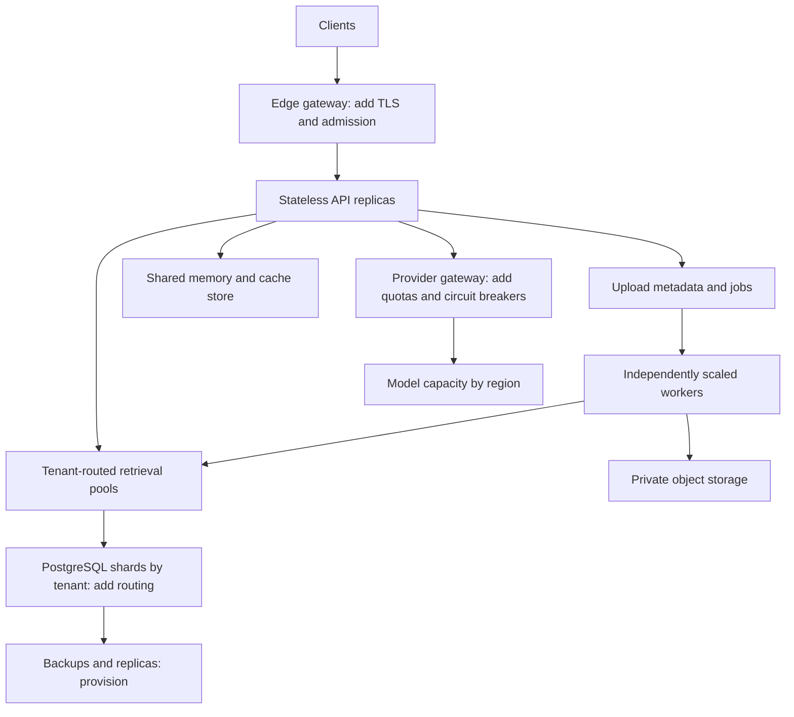

# Capacity design for 100K users

## Define “concurrent” before selecting infrastructure

100,000 signed-in users, 100,000 open connections and 100,000 simultaneous generations are different workloads. The repository has not been load-tested at any of those scales. The shipped HPA is an initial template; it is not evidence that 20 replicas satisfy the requirement.

Use `QPS = active_users × questions_per_user_per_second`. Little’s law gives `in_flight = QPS × mean_response_seconds` in a stable system. The following are planning scenarios, not measured results:

| Assumption | Query arrival rate | In-flight at 2.5 s average |
|---|---:|---:|
| 100K connected users; 2% ask one question every 30 s | 66.7 QPS | 167 |
| 100K active users; each asks one question every 30 s | 3,333 QPS | 8,333 |
| 100K requests arriving across a 5 s burst | 20,000 QPS during burst | 50,000 if service remains stable |

A literal requirement for 100K simultaneously executing generations implies even larger provider capacity. Specify acceptable queuing, response latency, arrival burst, cancellation behavior and per-tenant fairness first.

## A sizing worksheet

Measure these inputs with realistic data:

| Variable | Measurement needed |
|---|---|
| Sustainable QPS per API replica | End-to-end workload, including provider waits, under the p95 SLO |
| Cache hit ratio | Separately by tenant, conversation type and corpus update rate |
| Query embedding and generation quotas | Provider RPM/TPM, region-specific capacity and fallback availability |
| SQL time per query | Pool wait, tenant/version lock wait, vector search, FTS, cache and history writes |
| Ingestion throughput | Pages/s, chunks/s, embedding batches/s, queue age and retry ratio |
| Retrieval corpus | Chunks per tenant, largest tenant, filter selectivity and embedding dimensionality |

For an **assumed**, not measured, 25 sustainable QPS per API replica and a 65% utilization target:

`replicas = ceil(target_qps / (25 × 0.65))`

At 3,333 QPS this gives 206 replicas. The actual application uses blocking work in FastAPI’s thread pool for each query. Thread limits, model latency and pool size must be measured; adding replicas without sizing database pools can exhaust PostgreSQL first.

At 3,333 QPS and an assumed 3,000 input + 400 output tokens/query, raw generation demand is approximately **11.33 million tokens/s** before cache savings. This arithmetic makes provider capacity and economics an early gate. Model selection and pricing are intentionally not hard-coded.

## Target distributed architecture

This is the next-stage topology for qualification. Boxes marked “add” are not implemented services in this repository.



Keep query serving independent of ingestion CPU. Separate pools for parsing, embedding and indexing become useful if their bottlenecks differ. The current worker performs the stages serially per document; multiple workers supply concurrency. A queue-based fan-out/fan-in job graph is a future change, not a hidden feature.

## Where the current code will bottleneck

1. **SQLite** does full tenant-corpus scans and serializes writes. It is intentionally not a distributed serving backend. The scan cap fails explicitly instead of giving an incomplete result.
2. **Per-tenant locks** serialize admission, usage reservations and final corpus-version checks. A single very large tenant can dominate lock wait even when other tenants remain healthy.
3. **SQL caches and JSON history** add write traffic to the same database that serves retrieval. Move hot counters/cache to a shared atomic store and messages to append-only rows when measured contention justifies it. Preserve tenant/user/version keys and fail-closed budget semantics.
4. **One global HNSW index** can perform poorly with selective tenant filters. Measure recall and `EXPLAIN (ANALYZE, BUFFERS)` by tenant size/filter; use partitions or tenant-specific collections for heavy tenants.
5. **Provider quotas** can throttle embeddings and generation independently. Bounded retry is implemented; shared circuit breakers, regional failover and fair provider scheduling are not.
6. **Worker fairness** uses a global FIFO-ish SQL queue, not weighted fair scheduling. Per-tenant pending limits limit abuse but do not guarantee fair service across customer tiers.
7. **Conversation leases** prevent overlapping requests but add a timeout after a process crash. The current version does not support streaming cancellation or long-running generation heartbeats.

## Tenant routing and indexing choices

| Isolation/storage model | Use when | Tradeoff |
|---|---|---|
| Shared table + tenant predicate + RLS | Many small tenants | Simplest operations; must watch ANN filter selectivity and noisy neighbors |
| Hash/range partitioned corpus | High corpus size and predictable shard ownership | Requires query routing, partition-aware plans and operational tooling |
| Dedicated database/index per large tenant | Large enterprise tenants or strong contractual separation | Higher overhead and migration complexity; stronger resource boundaries |

Plan reindexing as a separate versioned corpus: ingest into the new fingerprint/index, evaluate recall and answer grounding, then atomically change the active routing reference. Existing code rejects embedding fingerprint changes rather than silently mixing models. A production blue/green corpus router is not implemented.

## Backpressure and autoscaling

Implemented controls: upload/body/parser/chunk bounds, per-tenant pending/document limits, query/minute reservations, daily token-unit reservations, finite provider timeouts, limited retry and dead letters.

For a real deployment, additionally configure:

- Edge concurrent-request and body limits, connection timeouts, TLS and request cancellation.
- Worker scaling from oldest queue age plus throughput, not CPU alone. The supplied worker metrics show outcomes; a queue-lag exporter/scaler must be added.
- API scaling from active requests, p95 latency and saturation alongside CPU.
- Total pool connection budget across all pods and a connection pooler suitable for transaction-local settings. Validate transaction pooling with RLS context tests.
- A bounded waiting room or `429` responses rather than unlimited in-memory model requests.
- Per-tier token/service budgets and global model provider rate controls.

## Qualification plan

1. Start with a representative corpus: tenant-count distribution, million-scale chunks where applicable, multiple languages and skewed metadata filters. The included synthetic documents are not a capacity corpus.
2. Measure uncached retrieval alone, uncached generation, and warm-cache paths separately. Report cache hit rates.
3. Ramp arrival rates, then hold each stage long enough to expose memory growth, checkpoint/autovacuum pressure and provider throttling. Use an open-loop arrival generator for overload behavior; the included script is a small closed-loop probe only.
4. Record p50/p95/p99 success latency, error/throttle rates, queue age, retrieval recall, CPU/RAM, DB wait events and provider token throughput. Never omit failed requests from the report without a separate breakdown.
5. Repeat with a hot tenant, ingestion during queries, deleted documents, pod termination, expired leases, database failover and provider 429s.
6. Establish sustainable capacity with headroom. Verify recovery time and backlog drain after a burst. Only then state a supported concurrency tier.

Example local probe, after provisioning a dedicated test tenant and setting a short-lived token:

```bash
export TF_TEST_TOKEN='YOUR_TOKEN'
python scripts/load_test.py --requests 20 --concurrency 4
python scripts/load_test.py --requests 20 --concurrency 4 --cold
```

Default query rate is 60/minute/tenant. Do not present rate-limited runs as successful throughput tests. Increasing limits in a dedicated benchmark environment changes the experiment; document it. Running provider mode consumes real quota and may incur charges.
